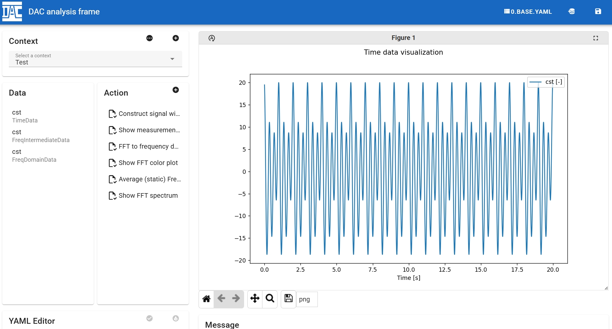

# DAC web


[DAC](http://github.com/miziper/dac.git) web version, which enables data processing via web browser with DAC frame way of working.

## Introduction



DAC web is a browser-based data analysis application built on the [DAC](http://github.com/miziper/dac.git) framework. Users create analysis sessions, configure data and action nodes in contexts, run actions, and visualize results via interactive matplotlib charts — all without leaving the browser.

## Features

- **Project management** — create, save, load, publish and share analysis projects; project history is tracked by creator signature with automatic inheritance on modification
- **Session isolation** — every analysis runs in its own subprocess, identified by UUID and proxied through the backend
- **Context / data / action nodes** — full CRUD over the DAC node model, with a YAML editor for configuration
- **Scenario system** — switch between scenarios that define available context types, action types and quick actions
- **Visualization** — matplotlib WebAgg integration renders interactive plots in the browser
- **Import / export** — export project configs and import them back, with a two-phase preview that proposes action replacements for review
- **Optional authentication** — Keycloak-based login (JWT); degrades gracefully when disabled
- **Dual storage** — PostgreSQL or flat JSON files, controlled by `DBSTORE`

## Architecture

```
Browser (SPA) ──→ FastAPI backend (:8000) ──→ per-session subprocess (random port)
                          │                           │
                    PostgreSQL / JSON files      matplotlib WebAgg
```

- **Frontend**: Svelte 5 SPA (`dac-frontend/`), served as static files by FastAPI in production
- **Backend**: FastAPI (`backend/`) manages sessions and proxies `/app/*` to the session subprocesses
- **Sessions**: each analysis session is a Python subprocess (`dac_web.app.entry`), isolated by UUID

## Requirements

- Python 3.12+
- Node.js 22+ with pnpm (frontend build only)
- Docker or Podman (container deployment)
- PostgreSQL 18+ (optional; falls back to file storage when unavailable)

## Deploy

To use the application, pack the backend and frontend into a container image with `docker` or `podman`.

```bash
podman build -t dac_web .
```

The default container image is also available at <https://hub.docker.com/r/miziper/dac_web>.

```bash
podman pull docker.io/miziper/dac_web
```

### Command to setup

```bash
podman run -p 8000:8000 dac_web
```

### Environment variables

| Variable | Default | Description |
|----------|---------|-------------|
| `DBSTORE` | `false` | `true` to use PostgreSQL, `false` for flat JSON files |
| `POSTGRES_HOST` | `localhost` | PostgreSQL host |
| `POSTGRES_PORT` | `5432` | PostgreSQL port |
| `POSTGRES_DB` | `dac` | PostgreSQL database name |
| `POSTGRES_USER` | `postgres` | PostgreSQL user |
| `POSTGRES_PASSWORD` | `password` | PostgreSQL password |
| `KEYCLOAK_URL` | `` | Keycloak server URL (enables auth when set with realm/client) |
| `KEYCLOAK_URL_PUBLIC` | `` | Public Keycloak URL for the frontend (defaults to `KEYCLOAK_URL`) |
| `KEYCLOAK_REALM` | `` | Keycloak realm |
| `KEYCLOAK_CLIENT_ID` | `` | Keycloak client ID |
| `KEYCLOAK_CLIENT_SECRET` | `` | Keycloak client secret |
| `FRONTEND_DIST` | `/app/frontend-dist` | Directory containing the built frontend |
| `PROJECT_DIR` | `/app/storage/projects` | Active project files (file storage) |
| `PROJECT_SAVE_DIR` | `/app/storage/projects_save` | Published/shared projects (file storage) |
| `SCENARIO_DIR` | dac built-in | Directory containing scenario definitions |
| `LOG_DIR` | `/app/storage/logs` | Session output logs |
| `APP_LOG_ON` | `1` | Capture session subprocess stdout/stderr on termination |

### Storage structure

With file storage (`DBSTORE=false`), analysis settings are stored under:

```
storage/
├── projects/       # active project .json files
├── projects_save/  # published/shared projects
└── logs/           # session output logs
```

With PostgreSQL (`DBSTORE=true`), projects live in the `nodes` table, with `histories` tracking the inheritance chain and `publishes` recording published projects. See `backend/dac_web/db/schema.sql`.

## Development

```bash
# Frontend dev server
cd dac-frontend && pnpm dev

# Frontend typecheck
cd dac-frontend && npx svelte-check --tsconfig ./tsconfig.app.json

# Frontend build
cd dac-frontend && pnpm build

# Backend
cd backend && uv run uvicorn dac_web.main:app --host 0.0.0.0 --port 8000
```

## License

Apache-2.0. See the backend package metadata (`backend/pyproject.toml`) for details.
